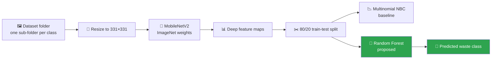

<div align="center">

# ♻️ AI-Powered Garbage Classification

### Smart waste sorting with transfer learning and a point-and-click desktop app

*MobileNetV2 deep features + a Random Forest classifier, built as an AI/ML project.*

<p>
  
  
  
  
</p>

<p>
  
  
  
</p>

</div>

---

## 📖 Overview

Improper waste segregation is one of the biggest bottlenecks in recycling. This project explores whether a lightweight computer-vision pipeline can tell different categories of garbage apart from a single photo.

Instead of training a convolutional network from scratch, the app uses a pretrained **MobileNetV2** as a feature extractor and trains classical classifiers on top of those features. A **Tkinter** GUI makes the entire workflow — dataset loading, feature extraction, training, evaluation and prediction — usable without touching the command line.

## ✨ Highlights

- 🧠 **Transfer learning first:** MobileNetV2 (ImageNet weights) turns every 331×331 image into a compact deep feature representation.
- 🌲 **Two models compared:** a Multinomial Naive Bayes baseline and a Random Forest classifier.
- 🖥️ **End-to-end GUI:** load a dataset, extract features, split, train, evaluate and classify a new image from one window.
- ⚡ **Cached features and models:** `model/X.npy`, `model/Y.npy`, `model/NBC_model.pkl` and `model/RFC_model.pkl` are reused on later runs.
- 📊 **Rich evaluation:** accuracy, weighted precision/recall/F1, a full classification report and a confusion-matrix heatmap.

## 🔬 Pipeline



1. **Load the dataset** — pick a folder where each class has its own sub-directory of `.jpg` images.
2. **Extract features** — each image is resized to 331×331, scaled with MobileNetV2 preprocessing, and passed through the pretrained base model.
3. **Split** — 80% training / 20% testing (`random_state=42`), with the shuffle order cached for reproducibility.
4. **Train and evaluate** — the Naive Bayes baseline and the proposed Random Forest are scored on the held-out set.
5. **Predict** — choose a test image and the app overlays the predicted class on the photo.

## 🗂️ Project structure

```text
Garbage-classification/
├── Main.py            # Tkinter app + full ML pipeline
├── Untitled.ipynb     # Exploratory notebook
├── run.bat            # One-click launcher for Windows
└── model/             # Auto-generated feature/model cache
```

> The `model/` folder is created automatically on the first feature-extraction run, so it is not committed.

## 🚀 Getting started

### 1. Clone the repository

```bash
git clone https://github.com/sanobar20/Garbage-classification.git
cd Garbage-classification
```

### 2. Create an environment and install dependencies

```bash
python -m venv .venv
.venv\Scripts\activate        # Windows
# source .venv/bin/activate   # macOS / Linux

pip install tensorflow scikit-learn scikit-image opencv-python pandas numpy \
            matplotlib seaborn joblib pillow imbalanced-learn catboost
```

### 3. Run the app

```bash
python Main.py
# or double-click run.bat on Windows
```

The first run downloads the MobileNetV2 ImageNet weights (about 14 MB).

## 🖱️ Using the app

| Step | Button | What happens |
|:--|:--|:--|
| 1 | **Upload Dataset** | Select the folder that contains one sub-folder per garbage class. |
| 2 | **MobileNetV2 Feature extraction** | Extracts and caches deep features for every `.jpg` image. |
| 3 | **Train Test Splitting** | Creates an 80/20 train-test split. |
| 4 | **Existing NBC** | Trains and evaluates the Naive Bayes baseline. |
| 5 | **Proposed RFC** | Trains and evaluates the Random Forest model and plots the confusion matrix. |
| 6 | **Upload test image** | Classifies a single image and shows the predicted label. |

### Expected dataset layout

```text
dataset/
├── cardboard/
│   ├── img001.jpg
│   └── ...
├── glass/
├── metal/
├── paper/
├── plastic/
└── trash/
```

## 🧰 Tech stack

| Layer | Tools |
|:--|:--|
| Deep features | TensorFlow / Keras, MobileNetV2 |
| Classical ML | scikit-learn (MultinomialNB, RandomForestClassifier) |
| Computer vision | OpenCV, scikit-image, Pillow |
| Visualization | Matplotlib, Seaborn |
| Interface | Tkinter |
| Persistence | NumPy, joblib |

## 📌 Notes and limitations

- The feature extractor is frozen; only the classifier is trained. This keeps training fast but limits fine-grained accuracy.
- Only `.jpg` files are picked up by the extraction loop.
- The app is designed for a local desktop workflow and expects the dataset on disk rather than a cloud bucket.

## 🛣️ Possible next steps

- [ ] Fine-tune the top layers of MobileNetV2 for higher accuracy.
- [ ] Support `.png`, `.jpeg` and `.webp` inputs.
- [ ] Add per-class confidence scores and a webcam mode.
- [ ] Export the model to TensorFlow Lite for an on-device mobile demo.

---

<div align="center">

**Built as an AI/ML academic project · Feel free to fork, learn and improve.**

⭐ If this project helped you, consider giving it a star!

</div>